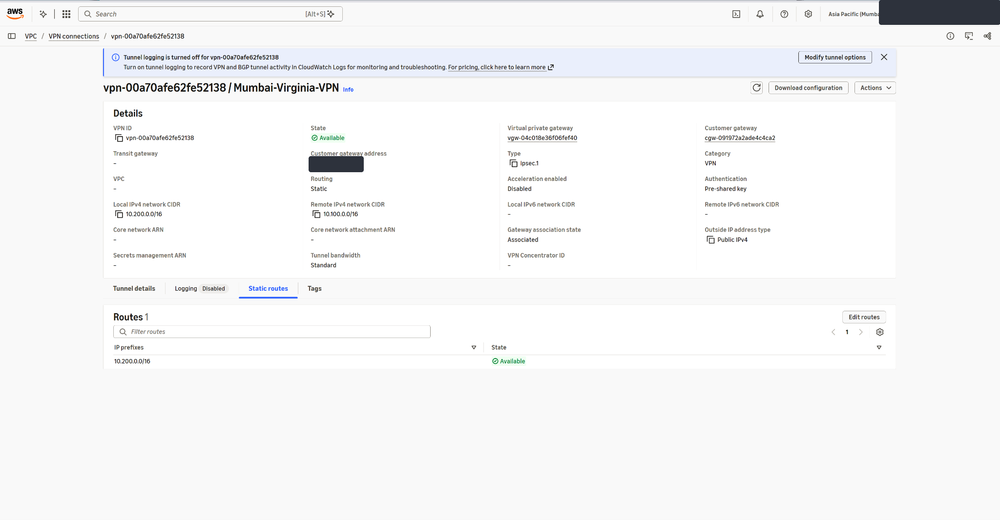
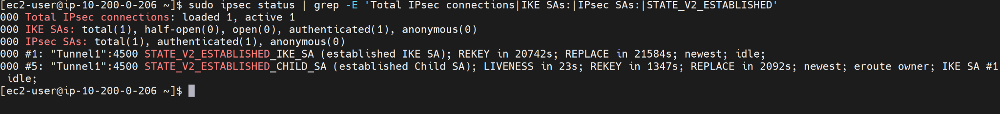

# AWS Multi-Region Site-to-Site VPN Lab

**Secure Cross-Region EC2 Connectivity Using AWS Site-to-Site VPN, Amazon Linux 2023, Libreswan 4.12, and IKEv2/IPsec**

A hands-on cloud networking and security project demonstrating the deployment, configuration, troubleshooting, and verification of an encrypted Site-to-Site VPN between AWS N. Virginia (`us-east-1`) and Mumbai (`ap-south-1`).

**Project Status:** Successfully tested | **Implementation Date:** November 22, 2026

## 1. Project Overview

The objective of this project was to establish secure communication between two Amazon VPCs deployed in different AWS Regions.

The N. Virginia VPC hosts an EC2-based customer gateway running **Amazon Linux 2023 and Libreswan 4.12**, while the Mumbai VPC connects through an **AWS Virtual Private Gateway**.

An IPsec VPN tunnel protects traffic traveling between the two networks, allowing the EC2 instances to communicate using their private IPv4 addresses.

The project includes practical experience with VPN negotiation, IKEv2 authentication, Linux IPsec configuration, static routing, packet-level troubleshooting, and encrypted traffic verification.

## 2. Project Objectives

- Configure VPCs in two AWS Regions.
- Deploy EC2 instances in separate network environments.
- Configure an AWS Virtual Private Gateway and Customer Gateway.
- Establish an IKEv2/IPsec Site-to-Site VPN.
- Use Libreswan as the customer-managed VPN endpoint.
- Configure static routes between VPC networks.
- Troubleshoot IPsec authentication and connectivity issues.
- Verify private IPv4 communication across Regions.
- Confirm encrypted traffic using ESP counters.

## 3. Network Architecture

| Component | Mumbai | N. Virginia |
|---|---|---|
| AWS Region | ap-south-1 | us-east-1 |
| VPC | VPC-A | VPC-B |
| VPC CIDR | 10.100.0.0/16 | 10.200.0.0/16 |
| EC2 private IP | 10.100.0.190 | 10.200.0.206 |
| VPN role | AWS Virtual Private Gateway | EC2-based Customer Gateway |
| VPN software | AWS-managed endpoint | Libreswan 4.12 |
| OS | Not recorded | Amazon Linux 2023 |

### Logical Traffic Flow

```text
              AWS Region: N. Virginia
              ┌──────────────────────────┐
              │ VPC-B: 10.200.0.0/16     │
              │                          │
              │ EC2-B                    │
              │ 10.200.0.206             │
              │ Amazon Linux 2023        │
              │ Libreswan 4.12           │
              │                          │
              │ Customer Gateway         │
              └────────────┬─────────────┘
                           │
                  IKEv2 / IPsec VPN
                  AES-256 / SHA-256
                           │
              ┌────────────▼─────────────┐
              │ AWS Virtual Private      │
              │ Gateway                  │
              │                          │
              │ VPC-A: 10.100.0.0/16     │
              │                          │
              │ EC2-A                    │
              │ 10.100.0.190             │
              └──────────────────────────┘
                 AWS Region: Mumbai
```

**Architecture note:** This is an AWS Site-to-Site VPN with a self-managed EC2-based customer gateway. It is not VPC peering or Transit Gateway peering.

## 4. AWS VPC Deployment

### 4.1 Mumbai VPC-A

The Mumbai network was created with CIDR `10.100.0.0/16`. The destination EC2 workload uses private IPv4 address `10.100.0.190`.


*Figure 1: Mumbai VPC-A and its IPv4 CIDR configuration.*

### 4.2 N. Virginia VPC-B

The N. Virginia network was configured with CIDR `10.200.0.0/16`.

EC2-B uses private IP `10.200.0.206` and acts as the Libreswan VPN endpoint.


*Figure 2: N. Virginia VPC-B configuration.*

## 5. AWS Site-to-Site VPN Configuration

The VPN architecture uses:

- AWS Virtual Private Gateway associated with the Mumbai VPC.
- AWS Customer Gateway representing the EC2-B VPN endpoint.
- AWS Site-to-Site VPN connection using static routing.
- IKEv2 and IPsec security associations.
- Pre-shared-key authentication.

The implementation successfully established **Tunnel 1**. Tunnel 2 was not configured for operational failover during this lab.


*Figure 3: AWS VPN tunnel details showing Tunnel 1 UP.*

## 6. Libreswan Configuration

### 6.1 Installation

Libreswan was installed on Amazon Linux 2023:

```bash
sudo dnf install -y libreswan
```

The service was enabled using systemd:

```bash
sudo systemctl enable ipsec
sudo systemctl start ipsec
```

### 6.2 Enable IP Forwarding

The following settings were used to enable forwarding and disable ICMP redirects:

```ini
net.ipv4.ip_forward=1
net.ipv4.conf.all.accept_redirects=0
net.ipv4.conf.all.send_redirects=0
```

These settings were stored in a file under `/etc/sysctl.d/` and applied using:

```bash
sudo sysctl --system
```

### 6.3 IPsec Configuration

A connection named `Tunnel1` was configured in `/etc/ipsec.d/aws.conf`.

**Sanitized example:**

```ini
conn Tunnel1
    authby=secret
    auto=start
    type=tunnel
    ikev2=insist

    left=%defaultroute
    leftid=<CUSTOMER_GATEWAY_PUBLIC_IP>
    leftsubnet=10.200.0.0/16

    right=<AWS_TUNNEL_OUTSIDE_IP>
    rightsubnet=10.100.0.0/16

    ike=aes256-sha2_256;modp2048
    phase2alg=aes256-sha2_256;modp2048

    ikelifetime=8h
    salifetime=1h

    encapsulation=yes
    dpddelay=30
    dpdaction=restart
```

This example omits deployment-specific public IP addresses and authentication secrets.

**Authentication security:** The pre-shared key was configured separately in `/etc/ipsec.secrets`, with restrictive file permissions. No actual PSKs are included in this repository.

### 6.4 Cryptographic Parameters

| Parameter | Negotiated configuration |
|---|---|
| IKE protocol | IKEv2 |
| Authentication | Pre-shared key |
| IKE encryption | AES-256-CBC |
| Integrity | SHA-256 |
| DH group | MODP2048 / Group 14 |
| ESP encryption | AES-256-CBC |
| NAT Traversal | UDP 4500 |
| Dead Peer Detection | Enabled |

## 7. Static Routing Configuration

After the VPN tunnel was established, private IPv4 communication initially failed because the remote network route was missing from the AWS VPN static routing configuration.

The required route was added:

```text
Destination: 10.200.0.0/16
```



*Figure 4: AWS VPN static route to the N. Virginia network.*

The Mumbai EC2 subnet route table also included:

| Destination | Target |
|---|---|
| 10.100.0.0/16 | local |
| 10.200.0.0/16 | Virtual Private Gateway |


*Figure 5: Mumbai private subnet route table showing the remote VPN route.*

Correct routing was essential to restore end-to-end connectivity after successful IPsec negotiation.

## 8. Troubleshooting and Root Cause Analysis

Several real configuration issues were identified and resolved.

### Issue 1: Incorrect VPN Tunnel Endpoint

**Symptom:** Libreswan repeatedly retransmitted `IKE_SA_INIT` requests without successfully establishing the VPN.

**Investigation:** Reviewed `journalctl` logs, captured UDP 500 traffic with `tcpdump`, and compared the configured peer address with the AWS-generated VPN settings.

**Root cause:** The peer's public tunnel endpoint address was entered incorrectly.

**Resolution:** Corrected the endpoint IP in the Libreswan connection configuration.

**Outcome:** The AWS endpoint began responding to IKE initiation traffic.

### Issue 2: Missing Pre-Shared Key Mapping

**Symptom:**

```text
authentication failed: no PSK found
Failed to find our PreShared Key
```

**Root cause:** The IPsec secrets entry still referenced the incorrect remote identity.

**Resolution:** Updated the peer identity mapping in `/etc/ipsec.secrets`, verified file permissions, and restarted the service.

**Outcome:** IKEv2 authentication completed successfully.

### Issue 3: Duplicate Configuration Include

**Symptom:** The IPsec main configuration included the same connection configuration directory twice.

**Root cause:** An include directive had been appended even though the default configuration already contained it.

**Resolution:** Removed the duplicate directive and validated the configuration.

**Outcome:** Connection definitions loaded without duplication.

### Issue 4: Tunnel UP but Private Ping Failed

**Symptom:** IKEv2 and IPsec Child Security Associations were established, but the destination EC2 instance did not respond to private-IP ping tests.

**Root cause:** The AWS VPN static route for the N. Virginia network was missing.

**Resolution:** Added the remote CIDR `10.200.0.0/16` to the VPN static routes and verified VPC routing.

**Outcome:** Private IPv4 connectivity succeeded.

### Issue 5: Zero IPsec Traffic Counters

**Symptom:** An established IPsec Child SA initially reported zero bytes transferred.

**Investigation:** Generated fresh ICMP traffic, then compared the ESP traffic counters before and after testing.

**Outcome:** The inbound and outbound counters increased, confirming that the traffic passed through the encrypted tunnel.

**Key takeaway:** A VPN tunnel showing UP does not automatically guarantee successful network connectivity. Authentication, routing, access controls, and application traffic must all be validated.

## 9. VPN Authentication Verification

Libreswan connection status was checked using:

```bash
sudo ipsec status
```

Relevant successful states included:

```text
Total IPsec connections: loaded 1, active 1

STATE_V2_ESTABLISHED_IKE_SA
STATE_V2_ESTABLISHED_CHILD_SA
```



*Figure 6: Successful IKEv2 authentication and established IPsec Child SA.*

## 10. End-to-End Connectivity Testing

The following test was performed from the N. Virginia EC2 instance:

```bash
ping -c 4 -W 2 10.100.0.190
```

Observed result:

```text
4 packets transmitted, 4 received, 0% packet loss
```

The final screenshot recorded approximately 200 ms average round-trip latency.


*Figure 7: Successful ICMP communication from N. Virginia to Mumbai over the VPN.*

**Note:** Latency varies with network conditions. The observed RTT is a lab measurement, not a guaranteed VPN performance benchmark.

## 11. Encrypted Traffic Verification

Encrypted traffic was verified by checking Libreswan traffic counters before and after generating ICMP traffic.

Command:

```bash
sudo ipsec trafficstatus
```

During one verification test, the counters increased as follows:

| Metric | Before ping | After ping |
|---|---|---|
| ESP inbound | 336 bytes | 672 bytes |
| ESP outbound | 336 bytes | 672 bytes |


*Figure 8: Increasing ESP traffic counters after successful ICMP testing.*

This provided additional evidence that bidirectional traffic was being processed through the IPsec security association.

## 12. Security Considerations

This lab demonstrates security practices and concepts including:

- Encryption of inter-network traffic using IPsec.
- IKEv2 authentication.
- AES-256 encryption and SHA-256-based integrity protection.
- Restrictive access to pre-shared-key files.
- Network segmentation using separate VPCs.
- Explicit traffic selectors.
- VPC routing and security group validation.
- Verification of encrypted traffic.

Public documentation intentionally excludes original VPN configuration downloads, pre-shared keys, private SSH material, and kernel output containing cryptographic session keys.

## 13. Limitations and Future Improvements

This was a hands
