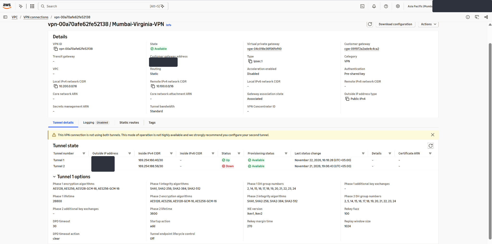
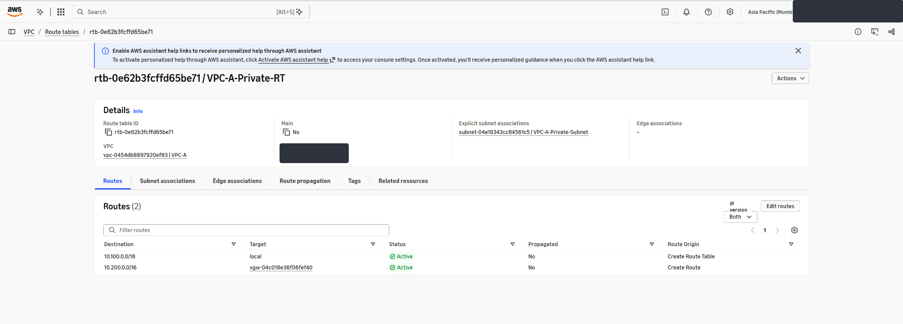
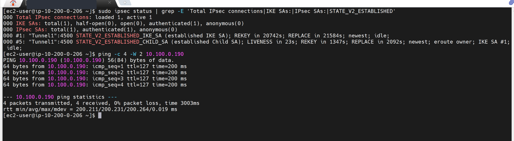

# AWS Multi-Region Site-to-Site VPN Lab

**AWS | Cloud Infrastructure | Network Security | IKEv2/IPsec | Libreswan | Linux**

A hands-on implementation of secure connectivity between two Amazon Virtual Private Clouds (VPCs) deployed across different AWS Regions using AWS Site-to-Site VPN and a Linux-based customer gateway.

This project demonstrates the configuration of AWS networking infrastructure, deployment of Libreswan on Amazon Linux 2023, establishment of an encrypted IPsec VPN tunnel, and troubleshooting of real connectivity, authentication, and routing issues.

The connection was successfully validated through private EC2-to-EC2 communication, established IPsec security associations, and encrypted traffic verification.

## Table of Contents

- [Network Architecture](#network-architecture)
- [Infrastructure Details](#infrastructure-details)
- [Technologies Used](#technologies-used)
- [Implementation](#implementation)
- [Troubleshooting and Problem Solving](#troubleshooting-and-problem-solving)
- [Testing and Verification](#testing-and-verification)
- [Final Results](#final-results)
- [Key Learnings](#key-learnings)
- [Limitations and Future Improvements](#limitations-and-future-improvements)
- [Conclusion](#conclusion)

---

## Network Architecture


*Figure 1: AWS Site-to-Site VPN architecture connecting Mumbai and N. Virginia.*

The architecture consists of two separate VPC networks deployed in different AWS Regions.

**Mumbai (ap-south-1)** hosts the destination EC2 instance within a private network connected to an AWS Virtual Private Gateway.

**N. Virginia (us-east-1)** hosts an EC2 instance running Amazon Linux 2023 and Libreswan 4.12, functioning as the customer-managed VPN endpoint.

An AWS Site-to-Site VPN connection establishes an encrypted tunnel between the Linux customer gateway and the AWS Virtual Private Gateway.

### Network Traffic Flow

```text
N. Virginia (us-east-1)
VPC-B: 10.200.0.0/16
        |
        |
EC2-B / Libreswan Gateway
Private IP: 10.200.0.206
        |
        |
Customer Gateway
        |
        |
   IKEv2 / IPsec
   Encrypted VPN
     Tunnel 1
        |
        |
AWS Virtual Private Gateway
        |
        |
Mumbai (ap-south-1)
VPC-A: 10.100.0.0/16
        |
        |
Private Route Table
        |
        |
EC2-A
Private IP: 10.100.0.190
```

The implemented configuration used static routing and pre-shared-key authentication.

**Implementation scope:** AWS provides two VPN tunnel endpoints for a Site-to-Site VPN connection. Only Tunnel 1 was configured and tested in this lab. Tunnel 2 was not implemented for redundancy or automatic failover.

---

## Infrastructure Details

### AWS Network Configuration

| Component | Mumbai | N. Virginia |
|---|---|---|
| AWS Region | ap-south-1 | us-east-1 |
| VPC Name | VPC-A | VPC-B |
| VPC CIDR | 10.100.0.0/16 | 10.200.0.0/16 |
| EC2 Instance | EC2-A | EC2-B |
| EC2 Private IP | 10.100.0.190 | 10.200.0.206 |
| VPN Role | AWS VPN endpoint | Customer-managed VPN endpoint |
| Gateway | Virtual Private Gateway | Customer Gateway |
| VPN Software | AWS-managed | Libreswan 4.12 |
| Operating System | Amazon Linux 2023 | Amazon Linux 2023 |

### VPN Configuration

| Parameter | Configuration |
|---|---|
| VPN Type | AWS Site-to-Site VPN |
| Routing | Static |
| Key Exchange | IKEv2 |
| IPsec Protocol | ESP |
| Encryption | AES-256 |
| Integrity | SHA-256 |
| Diffie-Hellman Group | MODP2048 |
| Authentication | Pre-Shared Key |
| IKE Lifetime | 8 hours |
| IPsec SA Lifetime | 1 hour |
| Operational Tunnel | Tunnel 1 |
| Redundant Tunnel | Not configured |

---

## Technologies Used

### AWS Services

- **Amazon VPC:** Creation and isolation of networks across AWS Regions.
- **Amazon EC2:** Deployment of the VPN gateway and destination workloads.
- **AWS Site-to-Site VPN:** Encrypted connectivity between the two network environments.
- **Virtual Private Gateway:** AWS-managed VPN endpoint attached to VPC-A.
- **Customer Gateway:** Representation of the Linux-based VPN endpoint.
- **Elastic IP:** Public addressing of the customer-managed VPN endpoint.
- **VPC Route Tables:** Forwarding traffic between the connected networks.
- **Security Groups:** Controlling permitted EC2 network traffic.

### Linux and Networking

- Amazon Linux 2023
- Libreswan 4.12
- IKEv2 and IPsec
- AES-256 and SHA-256
- Static Routing
- Linux IP Forwarding
- `ipsec`
- `journalctl`
- `tcpdump`
- `ping`
- Linux XFRM/IPsec Diagnostics

---

## Implementation

### Step 1: Configure the Mumbai VPC

A VPC was created in the Mumbai Region using the CIDR block `10.100.0.0/16`.

The environment included a private subnet and EC2 instance to serve as the destination for traffic originating from the N. Virginia network.

**Configuration:**

- Region: `ap-south-1`
- VPC: `VPC-A`
- CIDR: `10.100.0.0/16`
- Destination EC2 private IP: `10.100.0.190`


*Figure 2: Mumbai VPC configured with its dedicated IPv4 CIDR block.*

### Step 2: Configure the N. Virginia VPC

A second VPC was deployed in the N. Virginia Region using a separate, non-overlapping CIDR range.

An Amazon Linux 2023 EC2 instance was deployed in the network to function as the customer-managed VPN endpoint.

**Configuration:**

- Region: `us-east-1`
- VPC: `VPC-B`
- CIDR: `10.200.0.0/16`
- VPN EC2 private IP: `10.200.0.206`
- Operating System: Amazon Linux 2023
- VPN Software: Libreswan 4.12


*Figure 3: N. Virginia VPC configured for the customer-managed VPN endpoint.*

### Step 3: Configure AWS VPN Components

The VPN infrastructure required the following components:

**Virtual Private Gateway**

A Virtual Private Gateway was created and attached to the Mumbai VPC.

This gateway provides the AWS-managed endpoint for the VPN connection.

**Customer Gateway**

A Customer Gateway resource was created using the public IP address of the EC2-based VPN endpoint in N. Virginia.

**AWS Site-to-Site VPN Connection**

A Site-to-Site VPN connection was configured between the Virtual Private Gateway and Customer Gateway.

The connection used static routing and pre-shared-key authentication.

AWS provisioned two tunnel endpoints. The first tunnel was configured through Libreswan.



*Figure 4: AWS VPN connection showing Tunnel 1 in the UP state.*

### Step 4: Install and Enable Libreswan

Libreswan 4.12 was installed on the Amazon Linux 2023 EC2 instance.

**Install Libreswan:**

```bash
sudo dnf install -y libreswan
```

**Enable and start the IPsec service:**

```bash
sudo systemctl enable ipsec
sudo systemctl start ipsec
```

**Verify service status:**

```bash
sudo systemctl status ipsec --no-pager
```

Libreswan provides IKE negotiation, IPsec connection management, and integration with the Linux kernel's IPsec capabilities.

### Step 5: Configure Linux IP Forwarding

IP forwarding was enabled on the VPN gateway to support traffic forwarding between the connected networks.

Example persistent configuration:

`/etc/sysctl.d/99-vpn-lab.conf`

```ini
net.ipv4.ip_forward=1
net.ipv4.conf.all.accept_redirects=0
net.ipv4.conf.all.send_redirects=0
```

Apply the settings:

```bash
sudo sysctl --system
```

Forwarding, VPC source/destination checks, and network security rules must be configured appropriately when using an EC2 instance as a network gateway.

### Step 6: Configure the IPsec Tunnel

The Libreswan tunnel was configured using:

`/etc/ipsec.d/aws.conf`

The following example represents the IPsec connection parameters used in the lab. Public gateway addresses have been replaced with placeholders.

```ini
conn Tunnel1
    authby=secret
    auto=start
    type=tunnel
    ikev2=insist

    left=%defaultroute
    leftid=<CUSTOMER_GATEWAY_PUBLIC_IP>
    leftsubnet=10.200.0.0/16

    right=<AWS_TUNNEL_OUTSIDE_IP>
    rightsubnet=10.100.0.0/16

    ike=aes256-sha2_256;modp2048
    phase2alg=aes256-sha2_256;modp2048

    ikelifetime=8h
    salifetime=1h

    encapsulation=yes
    dpddelay=30
    dpdaction=restart
```

**Configuration explanation:**

| Parameter | Purpose |
|---|---|
| `conn Tunnel1` | Defines the VPN connection |
| `authby=secret` | Enables pre-shared-key authentication |
| `auto=start` | Starts the connection automatically |
| `ikev2=insist` | Requires IKEv2 |
| `leftid` | Identifies the customer gateway |
| `leftsubnet` | Defines the N. Virginia network |
| `right` | Identifies the AWS tunnel endpoint |
| `rightsubnet` | Defines the Mumbai network |
| `ike` | Specifies IKE cryptographic parameters |
| `phase2alg` | Specifies IPsec ESP cryptographic parameters |
| `dpdaction=restart` | Requests reconnection after dead peer detection |

This is a sanitized configuration reference, not a ready-to-deploy configuration.

The actual pre-shared key was stored separately in `/etc/ipsec.secrets`.

Example file permission commands:

```bash
sudo chown root:root /etc/ipsec.secrets
sudo chmod 600 /etc/ipsec.secrets
```

Actual VPN credentials and cryptographic keys are intentionally omitted from this documentation.

### Step 7: Configure Static Routing

Static routing was necessary to direct network traffic through the VPN connection.

**AWS VPN Static Route**

The remote N. Virginia CIDR was configured as an AWS VPN static route:

```text
Destination: 10.200.0.0/16
```


*Figure 5: VPN static route configured for the remote VPC network.*

**Mumbai Private Route Table**

The Mumbai VPC route table included the following entries:

| Destination | Target | State |
|---|---|---|
| 10.100.0.0/16 | Local | Active |
| 10.200.0.0/16 | Virtual Private Gateway | Active |



*Figure 6: Mumbai private subnet route table directing remote traffic to the Virtual Private Gateway.*

Correct routing was essential to allow communication between the two VPC environments.

---

## Troubleshooting and Problem Solving

Troubleshooting was one of the most significant parts of this implementation.

Although the initial AWS infrastructure and VPN configuration were deployed, several issues prevented successful tunnel establishment and private network communication.

Each issue required reviewing logs, verifying configuration parameters, and testing network behavior.

### Troubleshooting Summary

| Issue | Root Cause | Resolution |
|---|---|---|
| IKEv2 negotiation timeout | Incorrect AWS tunnel endpoint address | Corrected the remote endpoint |
| PSK authentication failure | Incorrect peer identity in the secrets configuration | Updated the identity mapping |
| Duplicate configuration loading | Repeated Libreswan include directive | Removed the duplicate directive |
| VPN UP but ping unsuccessful | Missing AWS VPN static route | Added the required remote network route |
| No new ESP traffic recorded | Traffic had not yet crossed the current SA | Generated test traffic and rechecked counters |

### Issue 1: IKEv2 Connection Timeout

**Problem**

During initial setup, Libreswan attempted to initiate the VPN connection but did not receive the expected response from the remote endpoint.

The logs included repeated IKEv2 retransmissions.

```text
STATE_V2_PARENT_I1
RETRANSMIT
No response (or no acceptable response)
```

**Investigation**

The issue was investigated by reviewing the Libreswan connection parameters, examining service logs, and checking IKE network traffic.

**Root Cause**

The configured AWS VPN tunnel endpoint contained an incorrect IP address.

**Resolution**

The remote endpoint address was corrected to match the AWS-provided tunnel configuration.

Following this change, the AWS VPN endpoint began responding to IKE negotiation requests.

### Issue 2: Pre-Shared-Key Authentication Failure

**Problem**

After correcting the tunnel endpoint, VPN negotiation progressed further, but authentication still failed.

Libreswan reported:

```text
authentication failed: no PSK found
Failed to find our PreShared Key
```

**Investigation**

The peer identities specified in the IPsec configuration were compared with the entries in the Libreswan secrets file.

**Root Cause**

The identity mapping in `/etc/ipsec.secrets` did not match the VPN peer identifiers.

**Resolution**

The secrets file was updated with the correct peer identity mapping.

After restarting the IPsec service, the connection successfully authenticated.

### Issue 3: Duplicate Libreswan Configuration Directive

**Problem**

During configuration review, a repeated include directive was identified in the main Libreswan configuration.

**Root Cause**

The same configuration directory was included more than once.

**Resolution**

The duplicate include directive was removed, leaving a single configuration include path.

This simplified configuration loading and eliminated the duplicate entry.

### Issue 4: VPN Established but Private Connectivity Failed

**Problem**

The AWS console showed Tunnel 1 as UP, and Libreswan confirmed established IKE/IPsec security associations.

However, the N. Virginia EC2 instance could not initially communicate with the private EC2 instance in Mumbai.

**Investigation**

The troubleshooting process focused on:

- VPN connection state
- VPC route tables
- AWS VPN static routes
- Private network destinations
- ICMP connectivity tests

**Root Cause**

The AWS Site-to-Site VPN connection did not contain the required static route for the N. Virginia network.

**Resolution**

The missing static route was added, and the associated VPC routing was verified.

After correcting the route configuration, private EC2-to-EC2 communication succeeded.

**Key Finding**

An established IPsec tunnel does not automatically guarantee end-to-end network connectivity.

Routing, network policies, and traffic verification must also be correct.

### Issue 5: ESP Counters Initially Showed No New Traffic

**Problem**

After establishing the VPN tunnel, the current security association initially showed no encrypted traffic.

**Investigation**

The connection state and Linux IPsec traffic counters were reviewed.

**Resolution**

ICMP test traffic was generated between the connected networks.

The IPsec counters were checked again and showed increasing inbound and outbound traffic.

This provided additional evidence that packets were being processed through the established IPsec tunnel.

---

## Testing and Verification

The implementation was validated using three separate checks:

1. VPN tunnel establishment.
2. End-to-end private network connectivity.
3. Encrypted traffic verification.

### Test 1: Verify IPsec Security Associations

Libreswan connection status was inspected using:

```bash
sudo ipsec status
```

The observed output included:

```text
Total IPsec connections: loaded 1, active 1

STATE_V2_ESTABLISHED_IKE_SA
STATE_V2_ESTABLISHED_CHILD_SA
```

These states indicate that IKE negotiation was completed and an IPsec Child Security Association was established.


*Figure 7: Libreswan confirming established IKE and IPsec security associations.*

**Result:** Passed.

### Test 2: Verify Cross-Region Private Connectivity

A connectivity test was performed from the N. Virginia EC2 instance to the Mumbai EC2 instance using its private IPv4 address.

```bash
ping -c 4 -W 2 10.100.0.190
```

**Observed results:**

| Metric | Result |
|---|---|
| Source | N. Virginia EC2-B |
| Destination | Mumbai EC2-A |
| Destination Private IP | 10.100.0.190 |
| Packets Sent | 4 |
| Packets Received | 4 |
| Packet Loss | 0% |
| Average RTT | Approximately 200 ms |



*Figure 8: Successful private connectivity between the EC2 instances with zero packet loss.*

**Result:** Passed.

The test verified that the N. Virginia instance could reach the Mumbai instance using private network addressing.

### Test 3: Verify Encrypted Network Traffic

To verify that the established VPN was carrying traffic, IPsec traffic counters were examined.

```bash
sudo ipsec trafficstatus
```

Traffic counters were recorded before and after generating ICMP traffic.

| Counter | Before | After |
|---|---|---|
| ESP Inbound | 336 bytes | 672 bytes |
| ESP Outbound | 336 bytes | 672 bytes |


*Figure 9: Increasing IPsec inbound and outbound counters after connectivity testing.*

**Result:** Passed.

The increasing counters demonstrated that bidirectional traffic was being processed by the IPsec security association.

---

## Final Results

| Verification Area | Observed Outcome |
|---|---|
| Mumbai VPC Configuration | Completed |
| N. Virginia VPC Configuration | Completed |
| Virtual Private Gateway | Configured |
| Customer Gateway | Configured |
| AWS Site-to-Site VPN | Established |
| Tunnel 1 | UP |
| Libreswan 4.12 | Operational |
| IKEv2 Authentication | Successful |
| IPsec Child SA | Established |
| Static Routing | Verified |
| Private EC2 Connectivity | Successful |
| ICMP Packet Loss | 0% |
| Encrypted Traffic Counters | Increased in both directions |
| Tunnel 2 Failover | Not implemented |

**Overall outcome:** The lab successfully demonstrated encrypted Site-to-Site VPN connectivity between two AWS Regions using an EC2-based Libreswan customer gateway and an AWS Virtual Private Gateway.

---

## Key Learnings

This project provided practical experience in several important areas of AWS infrastructure and network security.

### AWS Networking

- Designing VPC networks with non-overlapping CIDR ranges.
- Understanding how AWS gateway components participate in VPN connectivity.
- Configuring and validating static routing between cloud networks.
- Identifying the relationship between route tables, VPN routes, and end-to-end connectivity.

### VPN and Network Security

- Understanding IKEv2 negotiation and IPsec security associations.
- Configuring Linux-based VPN connections using Libreswan.
- Managing VPN peer identities and pre-shared-key authentication.
- Verifying encrypted network traffic using IPsec counters.

### Linux Administration

- Installing and managing Linux networking services.
- Configuring IP forwarding.
- Reviewing system logs and networking diagnostics.
- Troubleshooting VPN connection failures.

### Problem Solving

The most valuable lesson was learning to approach connectivity problems systematically.

Rather than assuming an UP tunnel indicated a working network, the implementation required validating each layer independently:

**Tunnel establishment → Authentication → Routing → Private connectivity → Encrypted traffic verification**

This approach helped isolate the issues and confirm that the final connection worked as expected.

---

## Limitations and Future Improvements

The lab was designed to demonstrate a functional Site-to-Site VPN connection. It was not intended to represent a production-ready, highly available deployment.

The following enhancements were outside the verified implementation scope:

| Area | Future Improvement |
|---|---|
| Availability | Configure the second AWS VPN tunnel |
| Resilience | Test tunnel failover and recovery |
| Monitoring | Add VPN health monitoring and alerting |
| Application Testing | Validate application-level communication |
| Performance | Measure throughput and latency under load |
| Operations | Evaluate logging, maintenance, and configuration automation |

The AWS lab resources were removed after completing the implementation and verification.

The screenshots and documented results represent the completed lab environment rather than an active deployment.

---

## Conclusion

This project successfully demonstrated an encrypted AWS Site-to-Site VPN connection between VPC environments in Mumbai and N. Virginia.

Using Amazon Linux 2023, Libreswan 4.12, IKEv2, and IPsec, the VPN tunnel was established and validated through successful private EC2 communication and increasing encrypted traffic counters.

Beyond implementing the VPN, the project provided hands-on experience identifying and resolving real networking challenges involving endpoint configuration, authentication, and static routing.

It reinforced the importance of validating infrastructure at multiple levels instead of relying solely on service status indicators.

---

**Author:** Hafiz Naeem Akmal

**GitHub:** [github.com/NaeemAkmal](https://github.com/NaeemAkmal)

**Project Repository:** [AWS Multi-Region Site-to-Site VPN Lab](https://github.com/NaeemAkmal/aws-multi-region-site-to-site-vpn-lab)

*AWS Cloud Infrastructure and Networking Lab | November 2026*
