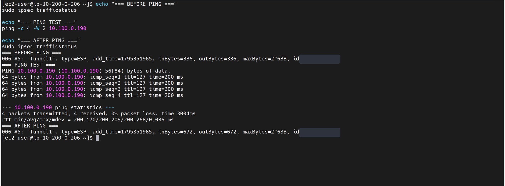

# AWS Multi-Region Site-to-Site VPN Lab

**AWS | Cloud Networking | IPsec | IKEv2 | Libreswan | Amazon Linux 2023**

This repository documents the implementation and testing of an AWS Site-to-Site VPN connecting two Virtual Private Clouds across the Mumbai (`ap-south-1`) and N. Virginia (`us-east-1`) Regions.

The VPN uses an EC2-based Customer Gateway running Libreswan 4.12 on Amazon Linux 2023 and an AWS Virtual Private Gateway. IKEv2 and IPsec provide encrypted communication between the two networks.

The implementation includes VPC configuration, VPN gateway setup, static routing, Linux IPsec configuration, troubleshooting, and verification of private EC2-to-EC2 connectivity.

---

## Network Architecture


The architecture connects two separate AWS VPC networks through an IPsec VPN tunnel.

| Component | Mumbai | N. Virginia |
|---|---|---|
| Region | ap-south-1 | us-east-1 |
| VPC | VPC-A | VPC-B |
| VPC CIDR | 10.100.0.0/16 | 10.200.0.0/16 |
| EC2 Instance | EC2-A | EC2-B |
| Private IP | 10.100.0.190 | 10.200.0.206 |
| VPN Component | Virtual Private Gateway | Customer Gateway |
| VPN Software | AWS-managed | Libreswan 4.12 |
| Operating System | Not recorded | Amazon Linux 2023 |

Only Tunnel 1 was configured and verified. The second AWS VPN tunnel was not implemented for failover.

## Technologies Used

- Amazon Web Services (AWS)
- Amazon VPC and EC2
- AWS Site-to-Site VPN
- Virtual Private Gateway
- Customer Gateway
- Amazon Linux 2023
- Libreswan 4.12
- IKEv2 and IPsec ESP
- AES-256 and SHA-256
- Static Routing
- Linux Networking Tools

---

## Implementation

### 1. VPC Configuration

Two VPCs were configured in separate AWS Regions with non-overlapping CIDR blocks.

**Mumbai — VPC-A**

- Region: `ap-south-1`
- CIDR: `10.100.0.0/16`
- EC2 private IP: `10.100.0.190`


*Figure 1: Mumbai VPC configuration.*

**N. Virginia — VPC-B**

- Region: `us-east-1`
- CIDR: `10.200.0.0/16`
- EC2 private IP: `10.200.0.206`
- OS: Amazon Linux 2023


*Figure 2: N. Virginia VPC configuration.*

### 2. AWS VPN Gateway Configuration

A Virtual Private Gateway was configured for the Mumbai VPC.

A Customer Gateway was created using the public endpoint of the N. Virginia EC2 instance.

An AWS Site-to-Site VPN connection was established using static routing and pre-shared-key authentication.


*Figure 3: AWS Site-to-Site VPN showing Tunnel 1 UP.*

### 3. Libreswan Installation

Libreswan was installed on the Amazon Linux 2023 EC2 instance.

```bash
sudo dnf install -y libreswan
```

Enable and start the IPsec service:

```bash
sudo systemctl enable ipsec
sudo systemctl start ipsec
```

Check service status:

```bash
sudo systemctl status ipsec --no-pager
```

### 4. IP Forwarding

IP forwarding was enabled to support VPN traffic.

The following settings were configured in `/etc/sysctl.d/99-vpn-lab.conf`:

```ini
net.ipv4.ip_forward=1
net.ipv4.conf.all.accept_redirects=0
net.ipv4.conf.all.send_redirects=0
```

Apply the configuration:

```bash
sudo sysctl --system
```

### 5. IPsec Configuration

The VPN connection was configured in `/etc/ipsec.d/aws.conf`.

The following is a sanitized example of the configuration used during the lab.

```ini
conn Tunnel1
    authby=secret
    auto=start
    type=tunnel
    ikev2=insist

    left=%defaultroute
    leftid=<CUSTOMER_GATEWAY_PUBLIC_IP>
    leftsubnet=10.200.0.0/16

    right=<AWS_TUNNEL_OUTSIDE_IP>
    rightsubnet=10.100.0.0/16

    ike=aes256-sha2_256;modp2048
    phase2alg=aes256-sha2_256;modp2048

    ikelifetime=8h
    salifetime=1h

    encapsulation=yes
    dpddelay=30
    dpdaction=restart
```

The actual VPN pre-shared key was stored separately in `/etc/ipsec.secrets`.

Access to the secrets file was restricted:

```bash
sudo chmod 600 /etc/ipsec.secrets
sudo chown root:root /etc/ipsec.secrets
```

No actual passwords, pre-shared keys, or private cryptographic material are included in this repository.

### 6. Static Routing

The VPN static route was configured for the remote network:

`10.200.0.0/16`


*Figure 4: VPN static route configuration.*

The Mumbai private subnet route table contained the following routes:

| Destination | Target | Status |
|---|---|---|
| 10.100.0.0/16 | Local | Active |
| 10.200.0.0/16 | Virtual Private Gateway | Active |


*Figure 5: Mumbai private route table configuration.*

---

## Troubleshooting

Several configuration issues were encountered and resolved during implementation.

| Issue | Cause | Resolution |
|---|---|---|
| IKEv2 connection timeout | Incorrect VPN tunnel endpoint IP | Corrected the remote peer IP |
| PSK authentication failure | Incorrect pre-shared-key identity mapping | Updated the secrets configuration |
| Duplicate connection configuration | Repeated include directive | Removed duplicate entry |
| VPN UP but private ping failed | Missing VPN static route | Added `10.200.0.0/16` |
| Zero ESP traffic counters | No traffic on the current security association | Generated ICMP traffic and verified counters |

### IKEv2 Connection Failure

The connection initially failed with repeated IKEv2 retransmissions.

```text
STATE_V2_PARENT_I1
RETRANSMIT
No response (or no acceptable response)
```

Packet inspection and configuration review identified an incorrect AWS VPN tunnel endpoint.

Correcting the endpoint allowed the AWS VPN service to respond to IKE negotiation requests.

### PSK Authentication Failure

After correcting the VPN endpoint, Libreswan reported:

```text
authentication failed: no PSK found
Failed to find our PreShared Key
```

The cause was an incorrect peer identity in the secrets configuration.

After correcting the identity mapping and restarting the IPsec service, authentication succeeded.

### Missing Static Route

The VPN tunnel successfully established, but private-IP communication initially failed.

The issue was resolved by adding the missing VPN static route for `10.200.0.0/16` and verifying the associated VPC routing.

This demonstrated that an established VPN tunnel does not automatically guarantee end-to-end connectivity.

---

## Verification and Testing

### VPN Connection Status

Libreswan connection status was verified using:

```bash
sudo ipsec status
```

The final results included:

```text
Total IPsec connections: loaded 1, active 1

STATE_V2_ESTABLISHED_IKE_SA
STATE_V2_ESTABLISHED_CHILD_SA
```


*Figure 6: Successful IKEv2 authentication and established IPsec Child Security Association.*

### Private EC2 Connectivity

Connectivity was tested from the N. Virginia EC2 instance to the Mumbai EC2 instance.

```bash
ping -c 4 -W 2 10.100.0.190
```

**Results:**

| Metric | Result |
|---|---|
| Source | EC2-B, N. Virginia |
| Destination | EC2-A, Mumbai |
| Destination IP | 10.100.0.190 |
| Packets transmitted | 4 |
| Packets received | 4 |
| Packet loss | 0% |
| Average latency | Approximately 200 ms |


*Figure 7: Successful private-IP communication between EC2 instances.*

### Encrypted Traffic Verification

IPsec traffic counters were checked using:

```bash
sudo ipsec trafficstatus
```

The observed counters increased after generating ICMP traffic.

| Metric | Before | After |
|---|---|---|
| ESP inbound | 336 bytes | 672 bytes |
| ESP outbound | 336 bytes | 672 bytes |



*Figure 8: IPsec encrypted traffic counters increasing after the ping test.*

The results confirm that bidirectional traffic was processed through the IPsec VPN tunnel.

---

## Final Results

| Component | Result |
|---|---|
| AWS VPC Configuration | Successful |
| AWS Site-to-Site VPN Tunnel 1 | UP |
| Libreswan 4.12 | Operational |
| IKEv2 Authentication | Established |
| IPsec Child Security Association | Established |
| Static Routing | Configured |
| Private EC2 Connectivity | Successful |
| ICMP Packet Loss | 0% |
| Encrypted Traffic | Verified |
| Tunnel 2 Failover | Not implemented |

## Key Learnings

This implementation provided practical experience in:

- Configuring AWS networking components across multiple Regions.
- Understanding Virtual Private Gateway and Customer Gateway functionality.
- Deploying a Linux-based IPsec VPN endpoint.
- Configuring IKEv2 authentication and encryption.
- Diagnosing network connectivity and authentication problems.
- Using `journalctl`, `tcpdump`, and Libreswan diagnostics.
- Troubleshooting missing network routes.
- Verifying encrypted traffic through ESP counters.

## Future Improvements

- Configure the second VPN tunnel for redundancy.
- Test VPN failover and recovery.
- Implement VPN monitoring and alerting.
- Perform application-level connectivity testing.
- Evaluate throughput and long-term connection stability.

---

## Conclusion

An AWS Site-to-Site VPN was successfully established between the Mumbai and N. Virginia Regions using Amazon Linux 2023, Libreswan 4.12, IKEv2, and IPsec.

The connection was verified through successful IKE/IPsec negotiation, private IPv4 communication between EC2 instances, and increasing encrypted traffic counters.

The project demonstrates practical cloud networking, Linux administration, network security, and troubleshooting skills.

---

**Author:** Hafiz Naeem Akmal  
**GitHub:** [NaeemAkmal](https://github.com/NaeemAkmal)

*Hands-on AWS Cloud Networking and Security Lab — November 2026*
