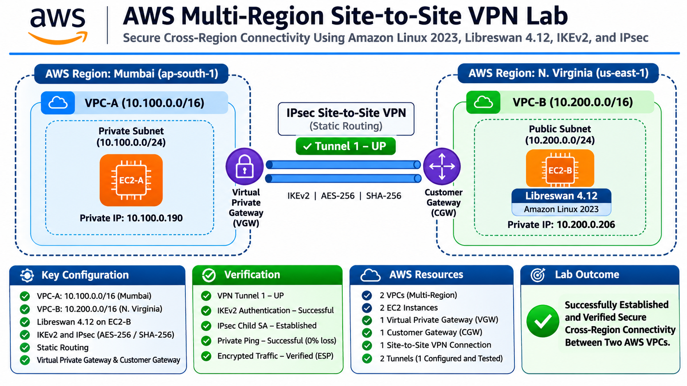
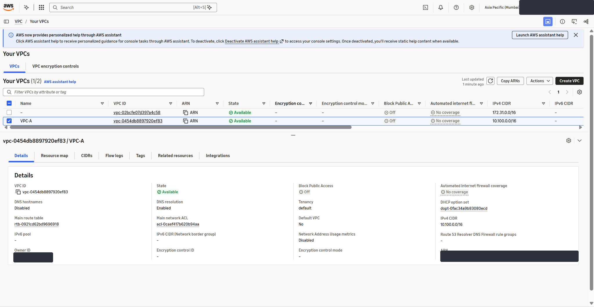
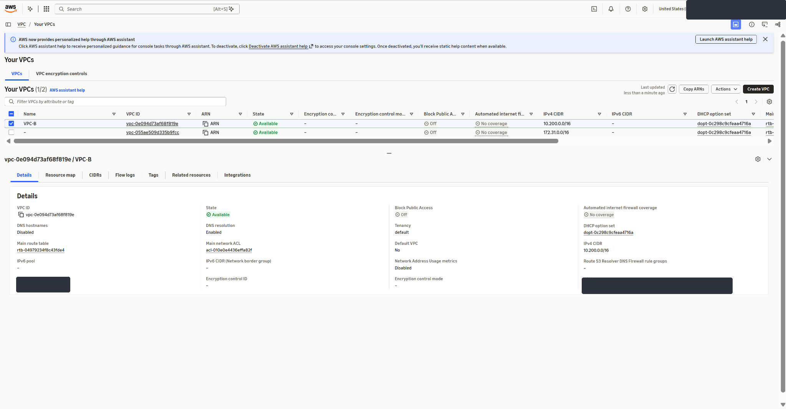

# 🔐 AWS Multi-Region Site-to-Site VPN Lab

### Secure Cross-Region Communication Using AWS, Libreswan, IKEv2 & IPsec

**Amazon Web Services | Cloud Security | Network Security | Linux Administration**



*Architecture overview: AWS Mumbai and N. Virginia VPCs connected through a Site-to-Site IPsec VPN using an EC2-based Customer Gateway and AWS Virtual Private Gateway.*

> **Project Status:** Successfully Implemented & Tested  
> **Completed:** November 22, 2026  
> **Environment:** Hands-on AWS Cloud Networking Lab  
> **Implementation:** Single Operational VPN Tunnel (Tunnel 1)

---

## 📖 Project Overview

This project demonstrates the design, implementation, troubleshooting, and verification of an **AWS Multi-Region Site-to-Site VPN** connecting two isolated Virtual Private Clouds (VPCs) across different AWS Regions.

The goal was to establish secure, encrypted communication between two EC2 instances using their **private IPv4 addresses**, rather than exposing the destination workload through the public internet.

The architecture connects:

- **AWS Mumbai (`ap-south-1`)** — VPC-A, hosting a private EC2 instance.
- **AWS N. Virginia (`us-east-1`)** — VPC-B, hosting an Amazon Linux 2023 EC2 instance configured as a customer-managed VPN endpoint using Libreswan 4.12.

The VPN uses **IKEv2 and IPsec**, with AES-256 encryption, SHA-256 integrity protection, and static routing.

Beyond setting up the VPN, this lab involved identifying and resolving real configuration issues involving IKE negotiation, pre-shared-key identity mapping, duplicated configuration directives, and missing VPN routes.

### Key Achievements

- Established an authenticated IKEv2/IPsec VPN tunnel.
- Connected two AWS VPC networks across different Regions.
- Configured Libreswan 4.12 on Amazon Linux 2023.
- Implemented static VPN and VPC route table entries.
- Resolved endpoint and authentication configuration failures.
- Diagnosed and fixed a missing VPN static route.
- Verified successful EC2-to-EC2 private IPv4 communication.
- Confirmed bidirectional encrypted traffic through IPsec ESP counters.

---

## 🏗️ Network Architecture

### Architecture Details

| Component | AWS Mumbai | AWS N. Virginia |
|---|---|---|
| AWS Region | `ap-south-1` | `us-east-1` |
| VPC Name | VPC-A | VPC-B |
| VPC CIDR | `10.100.0.0/16` | `10.200.0.0/16` |
| EC2 Instance | EC2-A | EC2-B |
| EC2 Private IPv4 | `10.100.0.190` | `10.200.0.206` |
| VPN Gateway Role | Virtual Private Gateway | Customer Gateway |
| VPN Software | AWS-managed VPN endpoint | Libreswan 4.12 |
| Operating System | Not independently recorded | Amazon Linux 2023 |
| Routing | Static routes | IPsec traffic selectors |

### How the Architecture Works

1. The N. Virginia EC2 instance runs Libreswan and acts as the customer-managed VPN endpoint.
2. AWS provides a Virtual Private Gateway associated with the Mumbai VPC.
3. An IPsec tunnel establishes encrypted communication between the two endpoints.
4. Static routing directs the permitted private network traffic through the VPN.
5. EC2-B communicates with EC2-A using its private IPv4 address.
6. IKEv2 provides tunnel negotiation and authentication, while IPsec ESP protects the network traffic.

**Architecture clarification:** The implementation uses AWS Site-to-Site VPN with a self-managed EC2 Customer Gateway, not VPC Peering or Transit Gateway Peering.

---

## 🛠️ Technologies & Services Used

### AWS Services

| Service | Purpose |
|---|---|
| Amazon VPC | Isolated cloud networks |
| Amazon EC2 | Workloads and VPN gateway host |
| AWS Site-to-Site VPN | Managed VPN tunnel endpoint |
| Virtual Private Gateway | VPN connectivity for Mumbai VPC |
| Customer Gateway | Defines the customer-managed VPN endpoint |
| Elastic IP | Stable public address for the VPN endpoint |
| Route Tables | Forwarding traffic to remote networks |
| Security Groups | Controlling permitted instance traffic |

### Linux & Security Technologies

| Technology | Purpose |
|---|---|
| Amazon Linux 2023 | EC2-B operating system |
| Libreswan 4.12 | IPsec VPN implementation |
| IKEv2 | Key exchange and authentication |
| IPsec ESP | Encrypted network traffic |
| AES-256-CBC | Data encryption |
| SHA-256 | Integrity protection |
| DH Group 14 | Key exchange |
| NAT Traversal | IPsec over UDP 4500 |
| tcpdump | IKE packet inspection |
| journalctl | VPN service troubleshooting |
| Linux XFRM | Kernel IPsec processing |

---

## ⚙️ Implementation Process

### Phase 1 — VPC Creation

Two isolated VPCs were configured in different AWS Regions.

#### Mumbai — VPC-A

- Region: `ap-south-1`
- VPC CIDR: `10.100.0.0/16`
- Destination instance: EC2-A
- Destination private IP: `10.100.0.190`



*Figure 1: AWS Mumbai VPC-A configured with the 10.100.0.0/16 CIDR.*

#### N. Virginia — VPC-B

- Region: `us-east-1`
- VPC CIDR: `10.200.0.0/16`
- VPN instance: EC2-B
- Private IP: `10.200.0.206`
- OS: Amazon Linux 2023
- VPN software: Libreswan 4.12



*Figure 2: AWS N. Virginia VPC-B configured with the 10.200.0.0/16 CIDR.*

### Phase 2 — Virtual Private Gateway and Customer Gateway

The AWS VPN infrastructure was configured using a Virtual Private Gateway for the Mumbai network and a Customer Gateway representing the Libreswan instance in N. Virginia.

An AWS Site-to-Site VPN connection was created with **static routing**.

The connection provides two AWS tunnel endpoints, but this lab configured and successfully verified **Tunnel 1 only**.


*Figure 3: AWS VPN Tunnel 1 successfully established. Tunnel 2 remained unconfigured for failover.*

### Phase 3 — Libreswan Installation

Libreswan was installed on the N. Virginia EC2 instance.

```bash
sudo dnf install -y libreswan
```

Enable and start the IPsec service:

```bash
sudo systemctl enable ipsec
sudo systemctl start ipsec
```

Check its status:

```bash
sudo systemctl status ipsec --no-pager
```

**Result:** The Libreswan service started successfully on Amazon Linux 2023.

### Phase 4 — Enable IP Forwarding

Linux IP forwarding was configured to support VPN traffic forwarding.

Relevant settings:

```ini
net.ipv4.ip_forward=1
net.ipv4.conf.all.accept_redirects=0
net.ipv4.conf.all.send_redirects=0
```

The settings were configured under `/etc/sysctl.d/` and applied using:

```bash
sudo sysctl --system
```

### Phase 5 — Configure IPsec Tunnel

The VPN connection was configured in:

`/etc/ipsec.d/aws.conf`

A sanitized example of the working connection configuration is provided below.

```ini
conn Tunnel1
    authby=secret
    auto=start
    type=tunnel
    ikev2=insist

    left=%defaultroute
    leftid=<CUSTOMER_GATEWAY_PUBLIC_IP>
    leftsubnet=10.200.0.0/16

    right=<AWS_TUNNEL_OUTSIDE_IP>
    rightsubnet=10.100.0.0/16

    ike=aes256-sha2_256;modp2048
    phase2alg=aes256-sha2_256;modp2048

    ikelifetime=8h
    salifetime=1h

    encapsulation=yes
    dpddelay=30
    dpdaction=restart
```

Replace the placeholders with the endpoint addresses generated for your own AWS VPN deployment.

The actual pre-shared key is deliberately excluded from this example.

### Phase 6 — Secure Authentication

The VPN used pre-shared-key authentication.

Secrets were stored separately in:

`/etc/ipsec.secrets`

File access was restricted:

```bash
sudo chmod 600 /etc/ipsec.secrets
sudo chown root:root /etc/ipsec.secrets
```

The secret file was not included in this repository.

### Phase 7 — VPN and Static Routing

The VPN static route was configured for the N. Virginia network.

| Destination | Purpose |
|---|---|
| `10.200.0.0/16` | Remote network reachable over VPN |


*Figure 4: VPN static route for the remote N. Virginia network.*

The Mumbai private subnet route table also included:

| Destination | Target | Status |
|---|---|---|
| `10.100.0.0/16` | Local | Active |
| `10.200.0.0/16` | Virtual Private Gateway | Active |


*Figure 5: Mumbai private subnet routing through the AWS Virtual Private Gateway.*

---

## 🔍 Troubleshooting & Root Cause Analysis

The VPN did not establish successfully on the first attempt. Multiple issues were investigated using Linux command-line tools and AWS configuration checks.

### Issue 1 — Incorrect VPN Peer Address

**Problem:** The connection repeatedly retransmitted IKEv2 initiation requests without successfully negotiating an IKE security association.

**Symptoms:**

```text
STATE_V2_PARENT_I1
RETRANSMIT
No response (or no acceptable response)
```

**Investigation:**

- Reviewed Libreswan connection settings.
- Inspected IPsec logs using `journalctl`.
- Used `tcpdump` to inspect outbound and inbound IKE traffic.
- Compared the configured endpoint with the AWS-generated VPN configuration.

**Root cause:** An incorrect AWS tunnel endpoint address was configured.

**Resolution:** Corrected the peer address in the Libreswan configuration.

**Outcome:** The AWS VPN endpoint began responding to IKE requests.

### Issue 2 — Pre-Shared Key Identity Mismatch

**Problem:** The tunnel reached the authentication stage but failed to locate a matching pre-shared key.

**Error:**

```text
authentication failed: no PSK found
Failed to find our PreShared Key
```

**Root cause:** The peer identity in the secrets file did not match the corrected VPN endpoint configuration.

**Resolution:** Corrected the identity mapping, verified permissions, and restarted Libreswan.

**Outcome:** IKEv2 authentication succeeded.

### Issue 3 — Duplicate Configuration Directive

**Problem:** The main IPsec configuration included the same connection directory twice.

**Root cause:** A configuration include directive had been appended even though it was already present.

**Resolution:** Removed the duplicate include and validated the configuration.

**Outcome:** The connection definition loaded cleanly.

### Issue 4 — VPN UP but Private Connectivity Failed

**Problem:** The VPN tunnel and IPsec security associations were established, but private-IP ping requests to the Mumbai EC2 instance initially failed.

**Investigation:**

- Reviewed VPN static routes.
- Checked VPC route tables.
- Verified IPsec traffic selectors.
- Examined the connection state and network configuration.

**Root cause:** The remote N. Virginia CIDR was missing from the AWS VPN static route configuration.

**Resolution:** Added:

```text
10.200.0.0/16
```

to the VPN static routes.

**Outcome:** Private network connectivity was restored.

### Issue 5 — Zero Encrypted Traffic Counters

**Problem:** The established Child Security Association initially displayed:

```text
inBytes=0
outBytes=0
```

**Resolution:** Generated new ICMP traffic and checked the counters again.

**Outcome:** Both ESP inbound and outbound counters increased, confirming encrypted traffic processing.

### Troubleshooting Lessons

- Verify VPN endpoint IPs against the AWS-generated configuration.
- Match PSK identities with the actual VPN connection identities.
- Inspect existing Linux configuration before adding directives.
- A tunnel showing UP does not automatically guarantee end-to-end connectivity.
- Static routing is essential for successful communication.
- Security Association counters provide evidence of encrypted traffic flow.

---

## ✅ VPN Establishment Verification

Libreswan was checked using:

```bash
sudo ipsec status
```

The final verification included:

```text
Total IPsec connections: loaded 1, active 1

IKE SAs: total(1), authenticated(1)
IPsec SAs: total(1), authenticated(1)

STATE_V2_ESTABLISHED_IKE_SA
STATE_V2_ESTABLISHED_CHILD_SA
```


*Figure 6: IKEv2 and IPsec Child Security Associations established successfully.*

This confirms successful IKE negotiation and IPsec security association establishment.

---

## 🌐 EC2-to-EC2 Private Connectivity Test

The connectivity test was performed from EC2-B in N. Virginia to EC2-A in Mumbai.

**Command:**

```bash
ping -c 4 -W 2 10.100.0.190
```

**Observed results:**

```text
4 packets transmitted
4 packets received
0% packet loss
```


*Figure 7: Successful ICMP communication between the N. Virginia and Mumbai EC2 instances.*

### Ping Results

| Metric | Observed result |
|---|---|
| Source | N. Virginia EC2-B |
| Destination | Mumbai EC2-A |
| Destination IPv4 | `10.100.0.190` |
| Packets sent | 4 |
| Packets received | 4 |
| Packet loss | 0% |
| Average RTT | Approximately 200 ms |

The final evidence screenshot confirms successful communication using the destination instance's private IPv4 address.

---

## 🔒 Encrypted Traffic Verification

IPsec ESP traffic counters were checked to verify that network packets were processed through the encrypted tunnel.

**Command:**

```bash
sudo ipsec trafficstatus
```

The test compared counters before and after a fresh ICMP ping sequence.

| Traffic direction | Before test | After test |
|---|---:|---:|
| ESP inbound | 336 bytes | 672 bytes |
| ESP outbound | 336 bytes | 672 bytes |


*Figure 8: ESP inbound and outbound byte counters increasing after the ICMP test.*

**Interpretation:** The counters increased in both directions, providing evidence that the VPN processed encrypted traffic during the test.

---

## 🛡️ Security Considerations

This lab demonstrates the following network security concepts:

- IPsec encryption for inter-network traffic.
- IKEv2 key negotiation and authentication.
- AES-256-CBC encryption.
- SHA-256-based integrity protection.
- Pre-shared-key authentication.
- Restricted permissions for credential files.
- Separate VPC address spaces.
- Static route and network traffic selector validation.
- ESP-based encrypted traffic verification.

### Credential and Evidence Safety

The public project documentation must not include:

- VPN pre-shared keys.
- Original AWS VPN configuration files containing credentials.
- SSH private keys.
- Linux XFRM dumps containing encryption or authentication keys.
- AWS account credentials or tokens.
- Unredacted sensitive diagnostic logs.

Screenshots are sanitized for public portfolio use.

---

## 📊 Final Project Results

| Validation | Result |
|---|---|
| Multi-Region VPC Setup | Successful |
| Amazon Linux 2023 VPN Host | Configured |
| Libreswan 4.12 | Operational |
| IKEv2 Authentication | Successful |
| IPsec Child SA | Established |
| VPN Tunnel 1 | UP |
| VPN Static Routing | Configured |
| Private EC2-to-EC2 Ping | Successful |
| ICMP Packet Loss | 0% |
| Final Ping RTT | Approximately 200 ms |
| ESP Inbound Traffic | Verified |
| ESP Outbound Traffic | Verified |
| Tunnel 2 Failover | Not implemented |

**Overall Outcome:** Successfully established and verified a working IPsec Site-to-Site VPN between AWS Mumbai and N. Virginia.

---

## 🚀 Future Improvements

This implementation was a hands-on lab and not a production-grade high-availability VPN environment.

Potential enhancements include:

1. Configure the second VPN tunnel.
2. Test tunnel redundancy and automatic failover.
3. Implement centralized VPN monitoring.
4. Evaluate additional logging and alerting.
5. Test application-layer communication.
6. Measure throughput under sustained traffic.
7. Explore high-availability customer gateway designs.

---

## 🎓 Skills Demonstrated

**AWS Networking:** VPC, EC2, Virtual Private Gateway, Customer Gateway, VPN, static routing.

**Cloud Security:** IPsec, IKEv2, encryption, authentication, network segmentation.

**Linux Administration:** Amazon Linux 2023, Libreswan, systemd, sysctl, Linux networking.

**Technical Troubleshooting:** Log analysis, IKE packet inspection, PSK mismatch diagnosis, VPN route troubleshooting.

**Validation:** Private connectivity testing, established Security Association verification, and encrypted traffic counter analysis.

---

## 🏁 Conclusion

This project provided practical experience implementing and troubleshooting an AWS Multi-Region Site-to-Site VPN using Libreswan on Amazon Linux 2023.

The main challenge was not simply establishing the IPsec tunnel, but ensuring that network authentication, traffic selectors, routing, and private connectivity worked together.

The final tests confirmed successful private IPv4 communication between the two AWS Regions, with zero ICMP packet loss and increasing ESP traffic counters in both directions.

The project demonstrates hands-on skills relevant to **Cloud Security Engineering, AWS Networking, Network Security, and Linux System Administration**.

---

### Project Information

**Author:** Hafiz Naeem Akmal  
**GitHub:** [NaeemAkmal](https://github.com/NaeemAkmal)  
**Project Repository:** [AWS Multi-Region Site-to-Site VPN Lab](https://github.com/NaeemAkmal/aws-multi-region-site-to-site-vpn-lab)

**Technologies:** `AWS` · `VPC` · `EC2` · `Site-to-Site VPN` · `Libreswan` · `IKEv2` · `IPsec` · `Cloud Security` · `Linux`

*This project was implemented for hands-on learning, practical networking experience, and technical portfolio documentation.*
